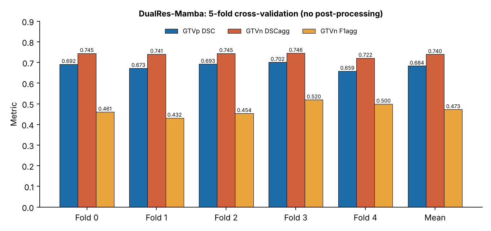
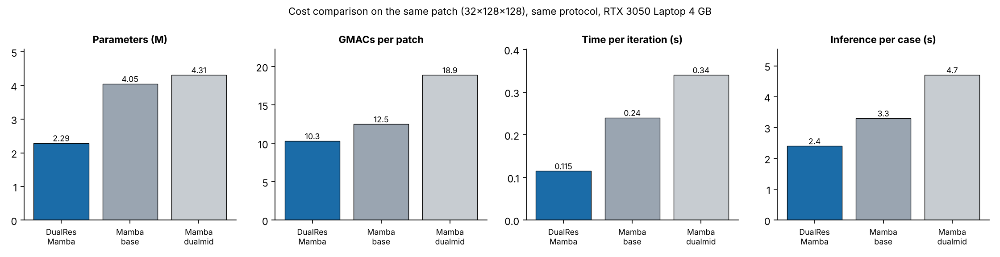

# Low-cost 3D PET/CT tumor segmentation (HECKTOR 2025): project showcase

Results and summary of my research project on segmenting the primary tumor (**GTVp**) and lymph nodes (**GTVn**) in head-and-neck PET/CT for the HECKTOR 2025 challenge (Task 1), using small 3D networks that train on a single **4 GB laptop GPU (RTX 3050)**.

> **The source code is not public** because the work is part of an ongoing thesis and paper. This repository only shows results. I am happy to walk through the code and methods in an interview, or to share access privately on request: dquinoneso@unsa.edu.pe

## Summary

- **Task:** 3D segmentation of tumor and lymph nodes from paired PET and CT volumes.
- **Constraint:** train and run everything on a 4 GB consumer GPU, so the focus is on accuracy per unit of compute.
- **Model:** DualRes-Mamba, a compact 3D network with separate PET and CT streams, factorized convolutions and a state-space (Mamba) block for long-range context. 2.29 M parameters.
- **Evaluation:** 5-fold cross-validation and a held-out 70/20/10 split, plus paired statistical tests (bootstrap and permutation) when comparing models.
- **Tooling:** Python, PyTorch, mixed precision (AMP), reproducible job scripts, 33 automated tests.

## Results

Without post-processing, on the native grid.

**5-fold cross-validation** (544 training / 136 validation cases per fold, 250 epochs; mean over folds):

| GTVp DSC | GTVn DSCagg | GTVn F1agg |
|---|---|---|
| 0.684 | 0.740 | 0.473 |

**Held-out split** (476 training cases, 69 test cases, PET normalized by absolute SUV):

| Set | Cases | GTVp DSC | GTVn DSCagg | GTVn F1agg |
|---|---|---|---|---|
| Test | 69 | 0.726 | 0.765 | 0.583 |
| Validation | 135 | 0.667 | 0.751 | 0.462 |

These runs use a single seed and 69 test cases, so small differences are within noise.

## Efficiency

Same patch size (32 x 128 x 128), same protocol, same session, RTX 3050 Laptop (4 GB). The two reference models are the strongest baselines from my previous project phase.

| | DualRes-Mamba | Baseline A | Baseline B |
|---|---|---|---|
| Parameters | 2.29 M | 4.05 M | 4.31 M |
| GMACs per patch | 10.3 | 12.5 | 18.9 |
| Training VRAM (batch 2) | 0.90 GB | 0.78 GB | 1.21 GB |
| Time per iteration | 0.115 s | 0.240 s | 0.340 s |
| Inference per case | 2.4 s | 3.3 s | 4.7 s |

Compared with Baseline B, the model has half the parameters and MACs, 26% less training VRAM, a third of the time per iteration and half the inference time.

## What I did

- Analyzed the dataset: per-center intensity distributions, PET/CT alignment and resampling loss.
- Designed and trained the models, and ran ablations on resolution, fusion strategy and context size.
- Measured cost (parameters, MACs, VRAM, time) with a documented protocol.
- Reviewed 25 related papers and compared against the published HECKTOR 2025 results.

## About

Daniel Quiñones, Computer Science, Universidad Nacional de San Agustín de Arequipa (Peru). [GitHub](https://github.com/DanielfQo) | [LinkedIn](https://linkedin.com/in/danielfqo)

Copyright (c) 2026 Daniel Quiñones. All rights reserved. The text and figures in this repository may not be reused or redistributed without permission.
